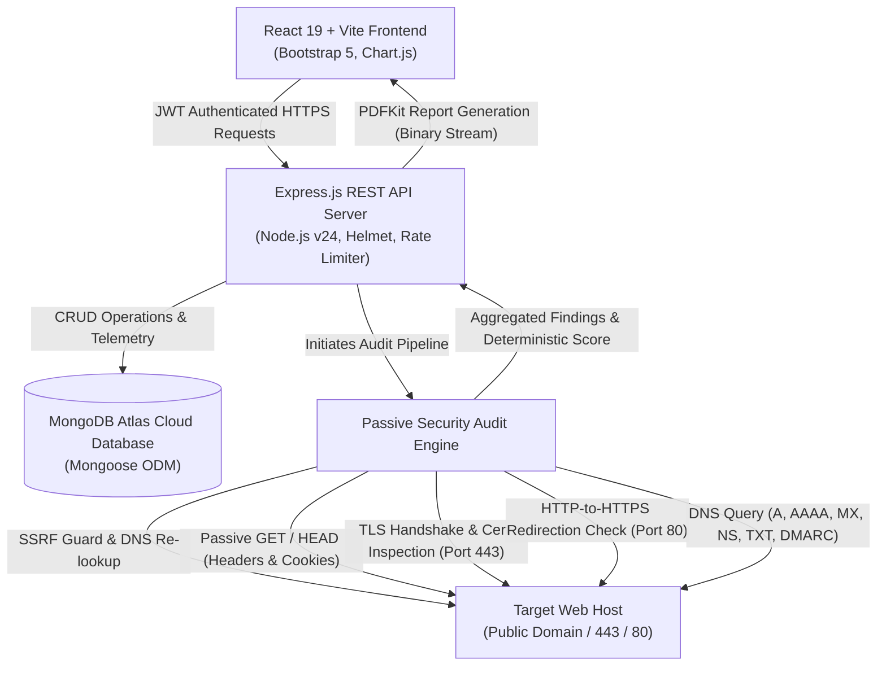
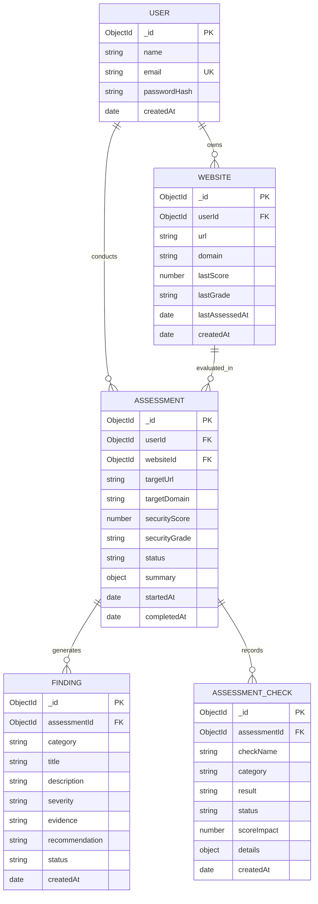

# SentinelScan System Architecture & Technical Design

## 1. Executive Architecture Overview

SentinelScan is an MCA-level Technical Training cybersecurity SaaS platform engineered for automated, passive, and non-invasive website vulnerability assessments. It enables security analysts, developers, and system administrators to inspect public-facing web applications for critical misconfigurations across HTTP headers, SSL/TLS certificates, plain-HTTP redirection posture, cookie directives, and DNS integrity.

---

## 2. Core Architectural Principles

1. **Passive & Non-Invasive Safety Constraint**:
   - Zero exploitation, zero vulnerability injection, zero denial-of-service, and zero brute force.
   - All tests interact strictly with standard public server banners, certificates, DNS records, and response headers.
2. **Strict Server-Side SSRF & DNS Rebinding Protection**:
   - Every user-supplied URL is parsed and validated against dangerous protocols (`file:`, `ftp:`, `gopher:`, `javascript:`).
   - Before any outbound network socket is opened, the destination hostname is resolved to all associated IPv4 and IPv6 addresses.
   - Resolved addresses are checked against RFC 1918 private subnets (`10.0.0.0/8`, `172.16.0.0/12`, `192.168.0.0/16`), loopback (`127.0.0.0/8`, `::1`), link-local/cloud metadata (`169.254.169.254`), and broadcast ranges.
3. **Cloud Database Persistence (MongoDB Atlas)**:
   - Zero dependency on local database binaries.
   - All user profiles, registered portfolios, assessment telemetry, findings, and technical checks persist in a managed MongoDB Atlas cluster via Mongoose ODM.
4. **Transparent, Deterministic Scoring**:
   - Objective point allocations across 4 security dimensions (Headers: 30%, SSL/TLS: 35%, Cookies: 15%, DNS: 20%).
   - Critical vulnerabilities impose a strict ceiling on the final score (e.g. invalid/expired SSL certificate restricts the score to <= 45 / Needs Improvement).

---

## 3. Database Schema & Entity Relationships

---

## 4. Assessment Engine Modules

| Module | Evaluated Parameters | Security Significance |
| :--- | :--- | :--- |
| **HTTP Headers** | CSP, HSTS, X-Content-Type-Options, X-Frame-Options, Referrer-Policy, Permissions-Policy | Mitigates XSS, Clickjacking, MIME-sniffing, SSL-stripping, and data leakage |
| **SSL / TLS** | Certificate trust chain, expiration countdown, CA Issuer, SAN hostname matching, TLS version (TLS 1.2/1.3) | Prevents MITM eavesdropping and insecure cryptographic cipher usage |
| **HTTPS Redirection** | Port 80 response status (301/308 vs 200), destination protocol matching | Enforces mandatory transport layer encryption for unauthenticated web visitors |
| **DNS Hygiene** | A, AAAA (IPv6), MX records, Nameserver redundancy (>= 2 NS), SPF TXT records, DMARC policy | Mitigates email spoofing, phishing domain impersonation, and single-point-of-failure DNS outages |
| **Cookie Security** | `Secure`, `HttpOnly`, `SameSite` flags on `Set-Cookie` headers | Protects session tokens from network eavesdropping, JavaScript theft (XSS), and CSRF attacks |

---

## 5. Security & Threat Modeling

1. **Threat**: Server-Side Request Forgery (SSRF) targeting internal services (e.g. `http://169.254.169.254/latest/meta-data/`).
   - **Defense**: Rigorous multi-tier IP check before request dispatch. Hostname resolution is validated against private/loopback/cloud subnets; requests targeting private IPs are rejected immediately.
2. **Threat**: DNS Rebinding Attack.
   - **Defense**: DNS lookup is executed immediately prior to connection, and all resolved IPs are inspected. Requests are tied to the approved public IP.
3. **Threat**: Authentication Brute Force.
   - **Defense**: `express-rate-limit` enforces rate ceilings on `/api/auth/*` endpoints (30 attempts per 15 minutes) and passwords are encrypted using bcrypt with salt rounds = 10.
4. **Threat**: Denial of Service (DoS) from High Frequency Scans.
   - **Defense**: Scan-specific rate limiters permit at most 20 scans per 5 minutes per user/IP. Target request streams timeout after 10–15 seconds.
