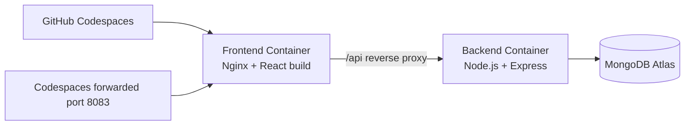

# SentinelScan Docker Containerization Case Study

## 1. Introduction to Docker
Docker packages an application and its runtime dependencies into an image. Containers created from that image run consistently across development and deployment environments.

## 2. Problem Statement
A full-stack SentinelScan deployment previously required separate Node.js, Nginx/build, environment, and networking setup steps. Containerization is used to make frontend and backend deployment repeatable without changing MongoDB Atlas or application source functionality.

## 3. Aim and Objectives
The aim is to run SentinelScan as two custom Docker containers: a production React build served by Nginx and an Express API. Objectives include Docker Hub image management, Dockerfiles, Compose orchestration, network isolation, reverse proxying, lifecycle management, resource inspection, and documented testing.

## 4. Existing Application Overview
SentinelScan uses React 19/Vite on the frontend, Express/Node.js on the backend, JWT and bcryptjs for authentication, and MongoDB Atlas through Mongoose. MongoDB remains external to Docker.

## 5. Architecture



Both containers share the `sentinelscan-network` bridge network. Only the frontend publishes host port `8083`; the backend remains internal on port `5000`.

## 6. Docker Image Management

```powershell
docker pull nginx:1.27.5-alpine
docker pull node:22.14.0-alpine
docker images
docker images -a
docker images -q
docker image inspect nginx:1.27.5-alpine
docker image inspect node:22.14.0-alpine
docker image history nginx:1.27.5-alpine
```

- `docker pull` downloads an image and tag.
- `docker images` lists local images.
- `docker images -a` is also useful to expose intermediate image records.
- `docker images -q` prints image IDs only.
- `docker image inspect` shows layers, architecture, environment, and configuration metadata.

## 7. Dockerfiles
The frontend Dockerfile builds Vite assets and copies them into official Nginx Alpine. The backend Dockerfile uses Node Alpine, installs production dependencies, and runs Express as the container's `node` user. Secrets are never copied; `.env` is excluded and loaded into Compose at runtime.

## 8. Docker Compose
The Compose file defines frontend/backend services, build contexts, custom images, restart policy, internal network, health checks, startup dependency, and port publishing. No Compose `version` field is used.

## 9. Container Networking
Compose creates the named `sentinelscan-network` bridge network. Nginx resolves the backend using the service DNS name `backend`.

## 10. Nginx Deployment
Nginx serves the SPA and uses `try_files` for React Router fallback. Requests beginning with `/api/` are proxied to `http://backend:5000`, including forwarded client headers. No personal Codespaces hostname is stored.

## 11. Port Mapping
`8083:80` maps Codespaces host port `8083` to Nginx port `80`. The backend exposes `5000` only to the Compose network.

## 12. Container Lifecycle

```powershell
docker compose ps
docker ps
docker ps -a
docker inspect sentinelscan-frontend-1
docker logs sentinelscan-backend-1
docker compose restart
docker compose stop
docker compose start
docker compose down
```

## 13. Resource Cleanup
Always inspect before pruning:

```powershell
docker version
docker system df
docker images
docker ps -a
```

Do not run prune commands until resources have been reviewed. The following are destructive or potentially destructive and require explicit confirmation:

```powershell
docker container prune
docker image prune
docker volume prune
```

`docker volume prune` removes unused volumes and can delete database data for projects that use volumes. It must not be used blindly for SentinelScan. Record reclaimable values from `docker system df` in the execution evidence.

## 14. Testing and Observations
At the Codespaces Docker daemon, execute:

```bash
docker compose build
docker compose up -d
docker compose ps
curl -fsS http://localhost:8083/api/health
docker compose logs --tail=100
```

### Testing record

| Test | Actual result | Evidence |
|---|---|---|
| Docker image creation | Not executed on unavailable Windows daemon | Record Codespaces output |
| Container creation/startup/status | Not executed on unavailable Windows daemon | Record Codespaces output |
| Port 8083/Nginx | Not executed on unavailable Windows daemon | Capture forwarded URL |
| Frontend-backend communication | Not executed on unavailable Windows daemon | Capture browser/curl health response |
| MongoDB Atlas | Not executed on unavailable Windows daemon | Capture backend logs |
| Registration/login | To be performed manually in deployed UI | Add screenshot |
| Assessment/results/PDF | To be performed manually in deployed UI | Add screenshot |
| Stop/start lifecycle | To be performed in Codespaces | Add output |

Do not add a Passed status to this table until the commands and browser actions are actually performed.

## 15. Advantages
- Repeatable builds
- Separation of frontend and backend runtime concerns
- Isolated network communication
- Simplified Codespaces deployment
- Independent restart and image lifecycle

## 16. Limitations
- The backend still depends on external MongoDB network reachability.
- Docker Desktop is not a substitute for a Docker daemon in the execution environment.
- Images and Compose state are local unless pushed or deployed remotely.
- Codespaces port forwarding is required for browser access.

## 17. Conclusion
The source application remains unchanged except for the production API base path and container support files. The final runtime is not claimed operational until a Docker engine executes and passes the documented checks.

## 18. Future Scope
Future work can add automated image publishing, CI/CD, non-root Nginx, secret managers, TLS termination, observability, and a staging environment.

## Screenshot Checklist

- [ ] Docker version output
- [ ] `docker images`
- [ ] Dockerfile contents
- [ ] docker-compose.yml contents
- [ ] Successful image build
- [ ] `docker compose ps`
- [ ] Running containers from `docker ps`
- [ ] Nginx configuration
- [ ] SentinelScan at forwarded port 8083
- [ ] Dashboard and assessment workflow
- [ ] Backend/frontend logs
- [ ] `docker system df`
- [ ] Container stop and restart evidence
